<div align="center">


# Kanbot

**A Kanban board where AI agents work the columns.**

Drag a ticket into a column and the agent that owns it picks it up.<br />
One plans, one builds, one reviews, one tests, one opens the pull request.<br />
You approve the plan, answer the questions and merge.

[](https://github.com/MatthewOsorio/kanbot/actions/workflows/ci.yml)
[](LICENSE)

<picture>
  <source media="(prefers-color-scheme: dark)" srcset="docs/images/board-dark.png" />
  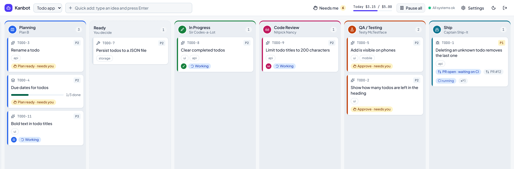
</picture>

<sub>The bundled sample todo app. The agents in these screenshots replay recorded and scripted runs, so none of this cost money.</sub>

</div>

## Drag once, then watch

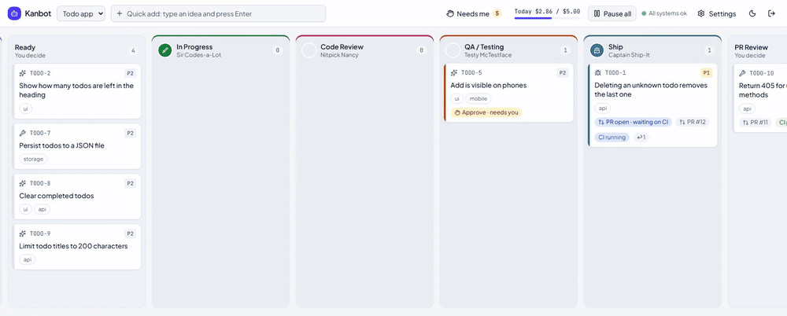

One drag, from Ready to In Progress. Sir Codes-a-Lot builds the plan in a git worktree and the project's checks run. Nitpick Nancy reviews the diff. Testy McTestface checks every acceptance criterion against the running app. Then the ticket stops and waits for your approval.

## How a ticket travels

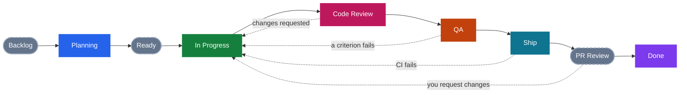

<picture>
  <source media="(prefers-color-scheme: dark)" srcset="docs/images/board-wide-dark.png" />
  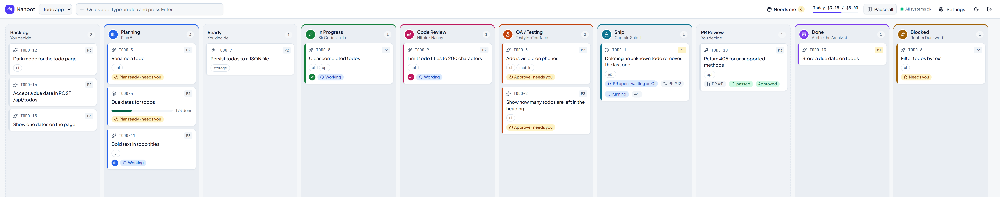
</picture>

- **The dashed columns are yours.** Backlog, Ready and PR Review have no agent. Dropping a ticket on Ready approves its plan, and QA's result waits for your approval before anything ships.
- **Work can bounce back.** Code Review, QA, CI and your own PR review each send a ticket back to In Progress with the reason attached. After three bounces it stops and asks you.
- **Stuck tickets go to Blocked.** Rubber Duckworth works out why and what to ask you. You answer, click Resume, and the agent carries on where it stopped.
- **Merging happens on GitHub.** Kanbot opens the pull request and watches CI, reviews and the merge. It never merges.

## Meet the crew

Each agent is a file: a model, a tool allowlist, a budget and a prompt. The jokes stay in the UI; the working prompts are plain.

| &nbsp;&nbsp;&nbsp;&nbsp;&nbsp;&nbsp;&nbsp;&nbsp;&nbsp;&nbsp;&nbsp;&nbsp; | Agent                                                                                                                | What it does                                                                                                                                                      | What it may touch                                                                              |
| :----------------------------------------------------------------------: | -------------------------------------------------------------------------------------------------------------------- | ----------------------------------------------------------------------------------------------------------------------------------------------------------------- | ---------------------------------------------------------------------------------------------- |
|                 | **Plan B**<br /><sub>Always has a backup plan.</sub><br /><sub>Planning · Opus 5.5</sub>                             | Turns a rough idea into a plan: the problem, acceptance criteria, steps, and the files it expects to touch. Splits epics into tickets.                            | Reads the repo. No edits, no shell.                                                            |
|        | **Sir Codes-a-Lot**<br /><sub>Knighted for services to the keyboard.</sub><br /><sub>In Progress · Opus 5.5</sub>    | Builds the approved plan with tests, in small commits. Comes back to fix what review, QA or CI found.                                                             | Edits inside the ticket's worktree, runs the project's own commands, commits locally. No push. |
|          | **Nitpick Nancy**<br /><sub>Has opinions about your semicolons.</sub><br /><sub>Code Review · Sonnet 5.5</sub>       | Reviews the diff against the plan: correctness, security, missing tests, scope creep, and clashes with other tickets in flight.                                   | Reads the repo, `git diff`, the linter. No edits.                                              |
|       | **Testy McTestface**<br /><sub>Breaks things professionally.</sub><br /><sub>QA · Sonnet 5.5</sub>                   | Checks each acceptance criterion against the running app, over HTTP and in a headless browser, with screenshots. Writes tests where the project has a test setup. | Test files only. The browser reaches the app and nothing else.                                 |
|        | **Captain Ship-It**<br /><sub>Fortune favors the merged.</sub><br /><sub>Ship · Sonnet 5.5</sub>                     | Writes the pull request description and the changelog entry. The worker then pushes the branch and opens the PR.                                                  | Markdown and `docs/` only. No GitHub token.                                                    |
|   | **Archie the Archivist**<br /><sub>Remembers everything so you don't have to.</sub><br /><sub>Done · Haiku 5.5</sub> | Writes a short retro: what was built, what it cost, what bounced and why.                                                                                         | Reads the repo.                                                                                |
|       | **Rubber Duckworth**<br /><sub>Quack. Tell me where it hurts.</sub><br /><sub>Blocked · Haiku 5.5</sub>              | Explains why a ticket is stuck and lists the exact questions you need to answer.                                                                                  | Reads the repo.                                                                                |

**Dr. Rabbit Hole** (Sonnet 5.5) takes a spike ticket in Planning instead of Plan B: he reads the repo and the web, and writes a research report with a recommendation and, if work follows, proposed tickets.

Not hired yet: Marge Conflict (merge conflicts, which go to Blocked for now).

## Everything lands on the ticket

Open a ticket and the whole story is there: what each agent did, what it cost, and what it needs from you.

<table>
  <tr>
    <td width="50%" valign="top">
      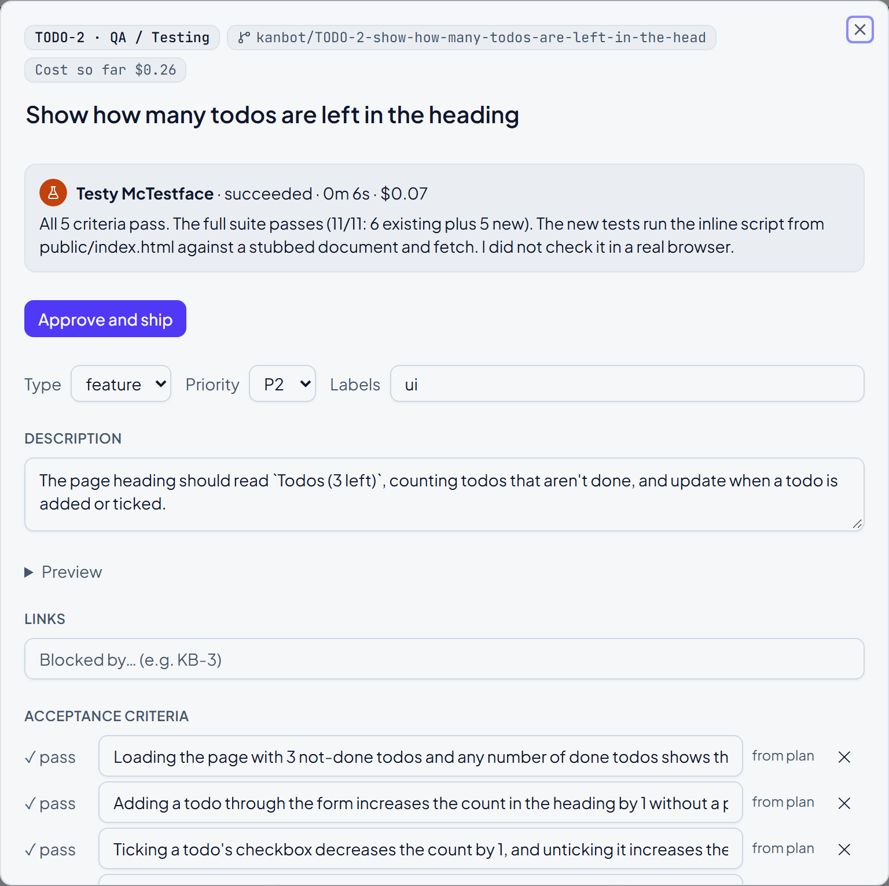
      <br />
      <b>One place to decide.</b> The latest run, the cost so far, each acceptance criterion's result, and the button that sends it on.
    </td>
    <td width="50%" valign="top">
      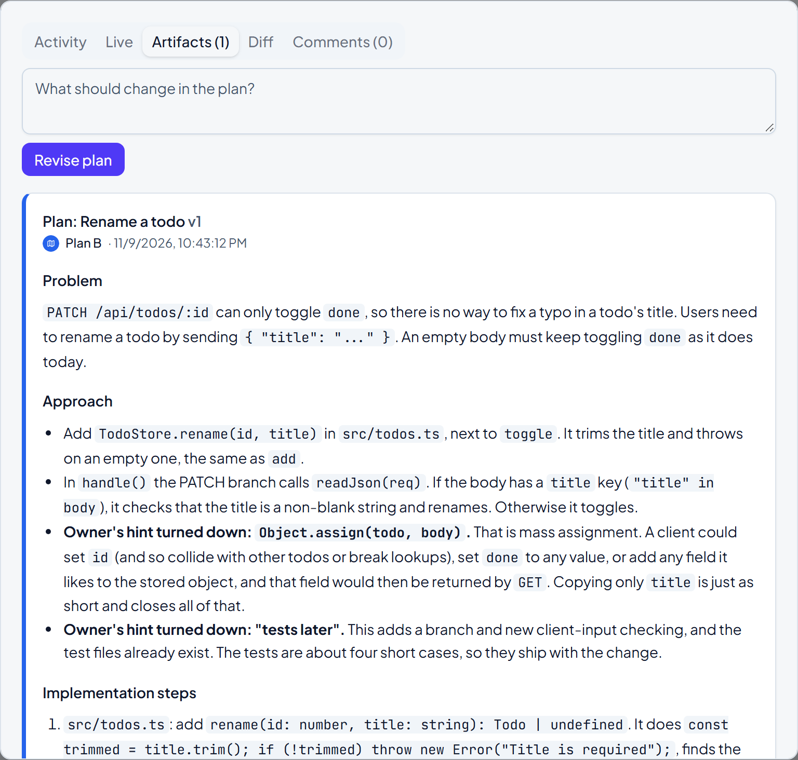
      <br />
      <b>A plan before any code.</b> Plan B reads the repo and writes the approach. Here it turns down the owner's own shortcut, and says why. Approve it, or ask for changes.
    </td>
  </tr>
  <tr>
    <td valign="top">
      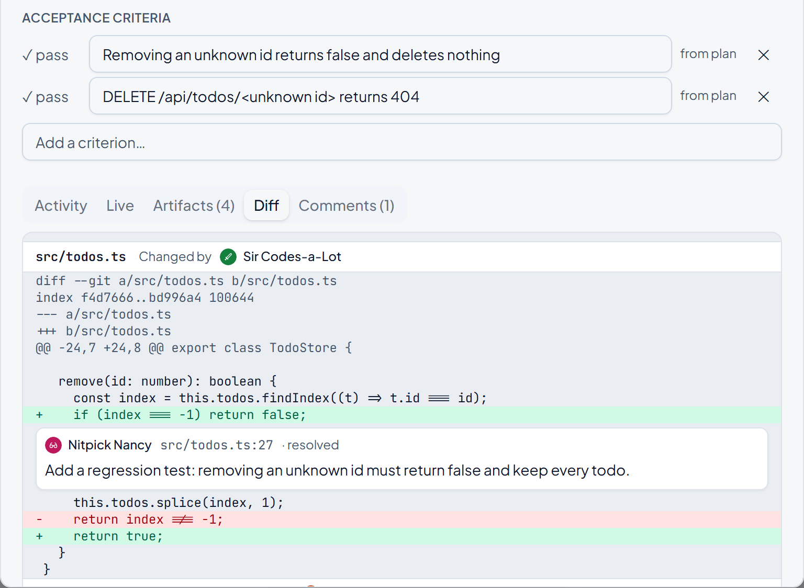
      <br />
      <b>A review on the diff.</b> Nancy's comments sit on the lines they are about, and the ticket goes back until they are resolved.
    </td>
    <td valign="top">
      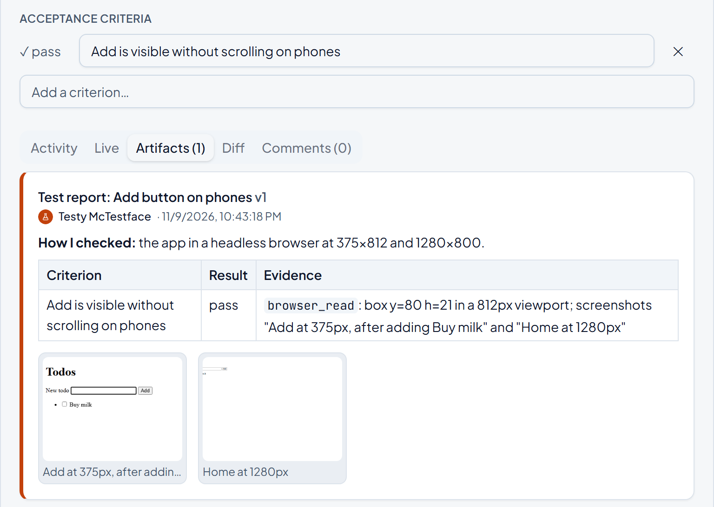
      <br />
      <b>QA with evidence.</b> Testy runs the app and checks each criterion in a headless browser. The screenshots stay on the ticket.
    </td>
  </tr>
  <tr>
    <td valign="top">
      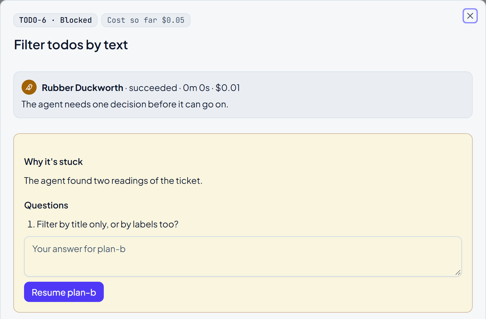
      <br />
      <b>Questions, not guesses.</b> When an agent can't decide, Duckworth asks. Your answer goes back to the agent that stopped.
    </td>
    <td valign="top">
      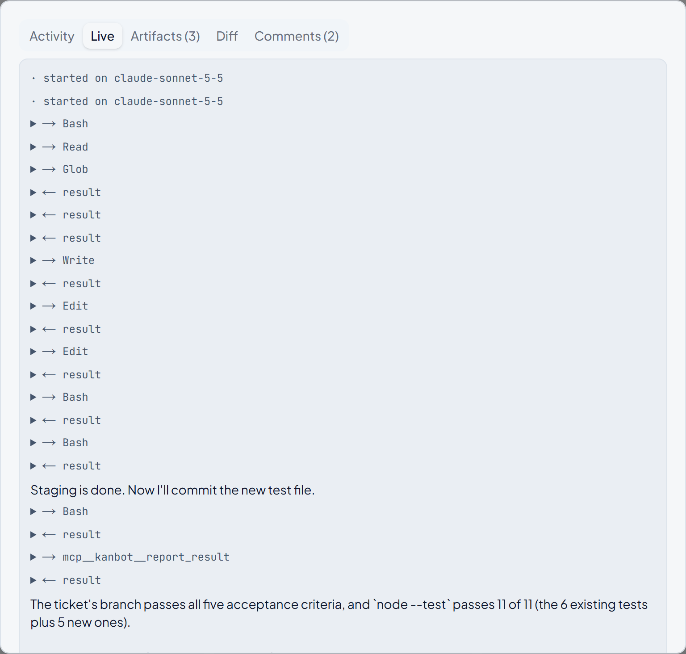
      <br />
      <b>A live log.</b> Every tool call streams in as the agent works, and stays there afterwards.
    </td>
  </tr>
</table>

## Guardrails

Agents run real commands, so each one is boxed in.

- **A worktree per ticket.** Agents work on a `kanbot/<KEY-n>-<slug>` branch in a worktree beside the checkout, never in the checkout itself.
- **A permission hook on every tool call.** Each agent's file lists the tools it may use. The hook refuses everything else: paths outside the worktree (symlinks included), shell commands that chain, pipe or redirect, `git push`, and anything that rewrites history.
- **Project code runs in its own container.** Under Docker Compose, build, test and the app QA checks run in a container from the project's own image (or a default one) with only the worktree mounted, never in the worker's container.
- **QA's browser is fenced to the app.** Requests to any other origin are aborted inside the tool.
- **Every run has a budget.** A dollar limit, a turn limit and a timeout come from the agent's file. A daily cap ($5 by default) stops new runs, and Pause all stops everything.
- **Loops end.** Three bounces, the same tool call three times, or 25 calls with no edit and no test run send the ticket to Blocked.
- **Nothing reaches main without you.** Kanbot's GitHub App opens the PR, so it can't approve it. Onboarding applies branch protection (one approving review, CI green), and agents don't start on an unprotected repo unless you override that.
- **Secrets stay out of prompts.** The API key and GitHub credentials are never put in a prompt, are stripped from the commands agents run, and are redacted from stored logs. A project's env vars are encrypted at rest.
- **Local only.** The app binds to 127.0.0.1 and every route needs the owner's GitHub sign-in.

## How it works

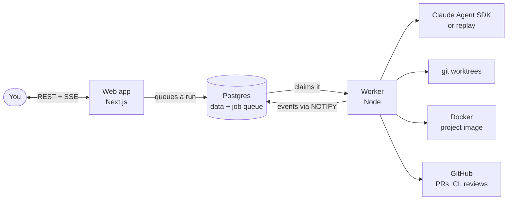

- **Two processes, one database.** The web app and the worker never call each other. The web app inserts a `queued` run, the worker claims it with `FOR UPDATE SKIP LOCKED`, and events travel back through `NOTIFY` to the browser as Server-Sent Events. There is no Redis.
- **Every run ends with a verdict:** `success`, `changes_requested`, `needs_input` or `failed`. A transition table, plain data in [`packages/shared/src/transitions.ts`](packages/shared/src/transitions.ts), decides where the ticket goes next.
- **A replay runtime for tests.** Recorded runs are JSON scripts in [`fixtures/runs`](fixtures/runs). Tests, CI and the screenshots above use them: no API key, no spend.

TypeScript (strict) · Next.js 16 · React 19 · Tailwind and shadcn/ui · dnd-kit · PostgreSQL 16 and Drizzle · Claude Agent SDK · Playwright · Vitest · Docker Compose

## Agents are files

One Markdown file per agent in [`agents/`](agents): frontmatter for the settings, the body for the system prompt. The worker reads the file at the start of each run, so a change applies to the next one.

```yaml
# agents/plan-b.md (shortened)
slug: plan-b
name: Plan B
tagline: Always has a backup plan.
color: "#2563eb"
column: planning
model: claude-opus-5-5
tools: [Read, Grep, Glob]
maxTurns: 40
timeoutMinutes: 15
maxBudgetUsd: 1.00
verdicts: [success, needs_input, failed]
statusLines:
  running: "Plan B is on it."
  success: "Plan B has a plan. And a backup plan."
  failed: "Plan B's plan didn't go to plan."
```

## Quick start

You need Node 26, pnpm 12, Docker, git and a GitHub account. Real agent runs also need an Anthropic API key.

```sh
git clone https://github.com/MatthewOsorio/kanbot.git
cd kanbot
cp .env.example .env        # then set the values below
pnpm install
docker compose up -d db     # Postgres 16 on 127.0.0.1:5432
pnpm db:migrate
pnpm dev                    # the web app on http://localhost:3000, plus the worker
```

In `.env`:

- `KANBOT_SESSION_SECRET` and `KANBOT_ENCRYPTION_KEY`: one `openssl rand -base64 32` each.
- `ANTHROPIC_API_KEY`: for real runs. Or set `KANBOT_RUNTIME=replay` for scripted agents: free, and enough for a first look.

Then open <http://localhost:3000>:

1. **Connect GitHub.** Kanbot creates its own GitHub App: one click to create it, one to install it on the repos you choose. The same App is your sign-in.
2. **Add a project.** Pick a repo. Kanbot clones it, detects its commands, runs a baseline, offers a CI workflow as a pull request and applies branch protection. A local folder works too, without the GitHub steps.
3. **Add a ticket and drag it to Planning.**

Real runs cost money. In the recorded runs on the sample app, a small ticket cost $0.26 to $0.43 from plan to passed QA.

To keep Kanbot running, [`docs/deploy.md`](docs/deploy.md) sets up the whole stack with Docker Compose in its own WSL distro. It has been run on Windows and WSL only so far.

## Development

| Command                                            | What it runs                                                                                 |
| -------------------------------------------------- | -------------------------------------------------------------------------------------------- |
| `pnpm typecheck`, `pnpm lint`, `pnpm format:check` | The static checks.                                                                           |
| `pnpm test`                                        | Vitest: unit tests, and the worker against a real Postgres with agents on replay.            |
| `pnpm test:e2e`                                    | Playwright, with its own dev server, database and replay worker.                             |
| `pnpm eval:agents`                                 | The golden tickets end to end with real agents, compared with a saved baseline. Costs money. |

CI is one workflow, [`ci.yml`](.github/workflows/ci.yml), and runs these same commands.

## Status

Kanbot is a personal project in active development, built for one developer on their own machine. The whole loop works today: it has taken real tickets on a real web app from Backlog to a merged pull request.

Still to come: rebasing branches as main moves, the two missing agents, a public server with webhooks (today it is localhost and a 60-second poll), and per-project columns.

- [`docs/requirements.md`](docs/requirements.md): the spec, with what is built and what is left (§16).

## Credits

- [Ponytail](https://github.com/DietrichGebert/ponytail) keeps the coding agents from writing code they don't need. Vendored in [`plugins/ponytail`](plugins/ponytail).
- Cloudflare's [security-audit skill](https://github.com/cloudflare/security-audit-skill) is Nitpick Nancy's security pass. Vendored in [`plugins/security-audit`](plugins/security-audit).
- The avatar glyphs are [Lucide](https://lucide.dev) icons.

## License

[MIT](LICENSE)
